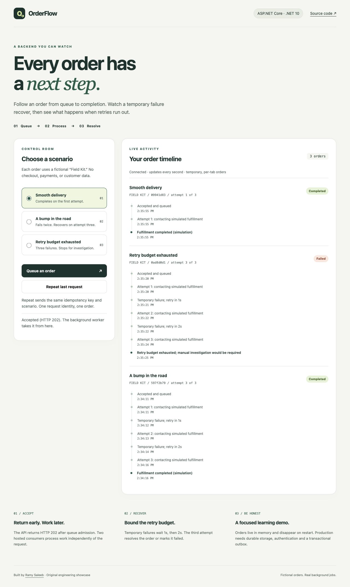
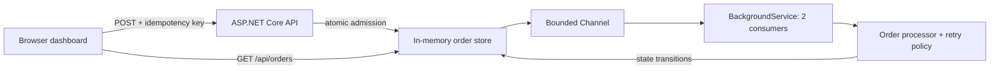

# OrderFlow

**Background jobs, made visible.** An original ASP.NET Core showcase by [Ramy Saleeb](https://github.com/RamySaleeb).

[](https://github.com/RamySaleeb/dotnet-orderflow/actions/workflows/ci.yml)

[](LICENSE)

Submit a fictional order and watch the backend work: queue admission, asynchronous processing, temporary failures, exponential backoff, and a terminal outcome. Repeat a request to see idempotency prevent duplicate jobs.

This is a **local, executable engineering demo**. There is no hosted deployment. The dashboard calls a real ASP.NET Core API and `BackgroundService`; only fulfillment is simulated. No customer data, payment provider, private code, or commercial system is involved.



## Run it in two commands

Install the [.NET 10 SDK](https://dotnet.microsoft.com/download/dotnet/10.0), clone this repository, and from its root run:

```sh
dotnet test --configuration Release
dotnet run --project src/OrderFlow --urls http://localhost:5088
```

Open **http://localhost:5088**. No database, API key, frontend build, or external service is required.

## A two-minute walkthrough

| Try | What to watch | Why it matters |
| --- | --- | --- |
| **Smooth delivery → Queue an order** | HTTP 202; queued → processing → completed on attempt 1 | Request acceptance and job completion are distinct events. |
| **A bump in the road** | Attempts 1 and 2 fail; waits of 1s and 2s; attempt 3 completes | Retries have explicit delays and a finite budget. |
| **Retry budget exhausted** | Three failed attempts; a final Failed state | Permanent failure stays visible instead of retrying forever. |
| **Repeat last request** | The same order is returned; the count stays unchanged | The same session, key, and payload don't create another job. |
| Queue several orders | Two consumers work while additional orders wait | Concurrency is bounded independently of HTTP requests. |

The dashboard polls every second, so a short-lived Queued or Processing state may pass between snapshots. Every transition remains in the timeline. Order IDs are shortened in the UI; API responses contain the full UUID.

### Quiet outcome announcements

Completed and failed orders update one persistent, polite, atomic status region outside the timeline. Each full order ID is announced once per page session, with its short ID and outcome. Unchanged polls and **Repeat last request** do not repeat outcomes; connection messages only change when the connection state changes.

The first successful poll silently hydrates terminal history. Orders still in progress announce when they finish; a new order submitted on this page before that first poll is also eligible. Multiple outcomes in one snapshot are grouped into one message listing completed and failed IDs. Reloading starts a new page session and keeps existing terminal history quiet.

For a keyboard walkthrough, select a scenario with the radio arrow keys, Tab to **Queue an order**, and press Enter. Focus stays on the control through polling and completion. Tab to **Repeat last request** and confirm the count and outcome stay unchanged. Try the exhausted-retry scenario for the failure announcement, then reload to check quiet hydration.

## Architecture



- **`Program.cs`** — HTTP validation, response semantics, dependency injection, security headers, submission rate limit, and static files.
- **`Adapters.cs`** — asynchronous admission/query contracts and one cancellable fulfillment attempt; the HTTP API depends on these boundaries.
- **`Orders.cs`** — immutable response snapshots, locked state transitions, scoped idempotency, bounded channel, retry policy, and hosted consumers.
- **`wwwroot/`** — responsive HTML/CSS/JavaScript dashboard with native keyboard controls and visible focus styles. No frontend framework.
- **`tests/OrderFlow.Tests/`** — concurrency, capacity, conflict, isolation, retention, cancellation, retry outcome, snapshot, and HTTP integration checks.

A single lock covers the idempotency check, queue admission, and store insertion. A consumer may dequeue immediately but cannot change state until insertion completes. Repeat requests return HTTP 200; new admissions return 202. A different payload for the same session/key returns 409.

## API examples

Both headers use non-empty UUIDs. `X-Demo-Session` separates the temporary order lists; it is a demo capability, **not authentication**. Keep it private if sharing a running instance.

```sh
curl -i http://localhost:5088/api/orders \
  -H 'Content-Type: application/json' \
  -H 'X-Demo-Session: 7e2e4888-3dc5-4da1-b7d2-9174fb011aa1' \
  -H 'Idempotency-Key: 13267869-9932-4906-b719-bc29d3a14e3a' \
  -d '{"scenario":"Recover"}'

curl http://localhost:5088/api/orders \
  -H 'X-Demo-Session: 7e2e4888-3dc5-4da1-b7d2-9174fb011aa1'
```

Repeat the POST unchanged for a replay. Change `Recover` to `Exhaust` with the same key to observe a 409 conflict. Allowed scenarios are `Success`, `Recover`, and `Exhaust`. `GET /health` returns 200 when the app is running.

## Deliberate limits and production tradeoffs

| Demo choice | Production direction |
| --- | --- |
| In-memory orders and `Channel<T>` | Durable queue, database, and transactional outbox so accepted work survives restarts. |
| At most 500 retained orders, 20 per session | Capacity planning, per-tenant quotas, monitoring, and explicit backpressure. |
| Terminal orders expire 30 minutes after completion/failure | Persistent retention and an explicit idempotency-key lifetime. Here expiry also ends the deduplication guarantee. |
| Two workers; retry delays occupy a consumer | Scheduled redelivery and jitter so retries don't monopolize workers or synchronize across services. |
| Deterministic fulfillment simulator | Timeout-aware adapters and classification of retryable versus permanent failures. |
| Random per-tab session stored in sessionStorage | Real authentication and authorization. Duplicated browser tabs may share the initial session. |
| Global limit of 60 submissions/minute | Distributed rate limiting and tenant-aware policies. GET polling is not rate limited. |
| Shutdown cancellation; pending work is lost | Durable recovery and graceful drain/requeue semantics. |

This does **not** claim exactly-once external effects or production readiness. The idempotency guarantee is process-local and applies only while the order is retained. Failed orders are visible; there is no real dead-letter queue, manual replay endpoint, checkout, inventory, or payment processing.

## Optional durable storage proposal

[ADR 0001](docs/decisions/0001-optional-durable-storage.md) proposes an opt-in PostgreSQL store and work queue, compares a broker/outbox alternative, and defines leases, crash recovery, retention, failure tests, and small implementation milestones. **Durability remains proposed.** The first code milestone extracts admission/query and single-attempt simulator interfaces, backed by the existing in-memory store. No database dependency or deployment has been added. The default SDK-only demo stays unchanged.

### Adapter boundaries available today

`IOrderAdmission` owns submission as one atomic operation; callers cannot separately save an order and enqueue it. `IOrderQueries` returns session-scoped snapshots. Both interfaces resolve to the same singleton `OrderStore` used by the two background consumers. Their async signatures allow a future I/O-based adapter; memory operations still use the existing lock and bounded Channel. A pre-canceled request is rejected before admission; cancellation after acceptance does not remove accepted work.

`IFulfillmentSimulator` executes one 700ms attempt and returns Completed or TransientFailure. `OrderProcessor` owns the three-attempt budget, state/event updates, and 1s/2s backoff. A durable claim/lease interface is deferred until the persistence milestone; the current worker remains explicitly in-memory.

All 39 original tests remain unchanged. Eleven additional cases cover shared DI composition, replaceable asynchronous HTTP boundaries, concurrent replay and immutable/session-scoped views through the interfaces, cancellation, fake-time single attempts, and injected outcomes. No database, container, environment variable, or new package is needed.

## Build and optional container

```sh
dotnet publish src/OrderFlow --configuration Release --output publish
# Optional, with Docker installed:
docker build -t orderflow .
docker run --rm -p 5088:8080 orderflow
```

Processor outcome tests advance `FakeTimeProvider` through 699ms/700ms processing and just-before/at-deadline backoff boundaries. A test-only timer-registration signal synchronizes async continuations; real time is used only as a deadlock guard. Cancellation tests cover both backoff waits and verify that advancing time afterward produces no new attempts or events.

Run the frontend regression suite with Node.js 24 or newer (no npm install or build step):

```sh
node --test tests/frontend/*.test.mjs
```

Validation: **38 backend tests and 12 frontend tests** pass, and the .NET release publish succeeds. API integration coverage checks missing, malformed, and all-zero UUID headers, rejected-request safety, independent orders for the same key in different sessions, and replay IDs/counts within each session. Cases use fresh sessions and 21 POSTs per fixture, below the shared 60/minute limit; they do not depend on worker timing or test order.

Frontend coverage includes quiet hydration, terminal transitions, multiple outcomes, replay/poll deduplication, early submission, and unchanged live-region writes.

Manual checks used the Codex in-app browser on macOS: keyboard submission/replay, focus retained through completion and failure, quiet reload, a 375px viewport, and a temporary local stylesheet doubling font sizes (including 28px action-button text). Controls wrapped without horizontal page overflow. The accessibility tree was inspected; VoiceOver/NVDA speech was **not** tested, and this is not a WCAG certification. Docker was not run because no Docker daemon was available.

The container runs as the .NET image's non-root application user. CI tests and publishes the app on pushes and pull requests. Docker is supplied as a convenience; no cloud resources are provisioned.

## Contribute

Read [CONTRIBUTING.md](CONTRIBUTING.md) for setup and PR expectations. Browse the completed roadmap below and the proposed follow-up milestones, and leave a comment on the issue before beginning so contributors can coordinate.

| Roadmap | Good fit |
| --- | --- |
| [#1 — Deterministic retry tests with FakeTimeProvider](https://github.com/RamySaleeb/dotnet-orderflow/issues/1) | Completed: controlled time and cancellation during both backoff waits |
| [#2 — Accessible order-outcome announcements](https://github.com/RamySaleeb/dotnet-orderflow/issues/2) | Completed: quiet outcome announcements and frontend regression coverage |
| [#3 — API validation and session-scoped idempotency tests](https://github.com/RamySaleeb/dotnet-orderflow/issues/3) | Completed: UUID validation, rejected-request safety, and session-scoped replay tests |
| [#4 — Optional durable queue/store design](https://github.com/RamySaleeb/dotnet-orderflow/issues/4) | Completed: [ADR 0001 proposal](docs/decisions/0001-optional-durable-storage.md); implementation awaits review |

Each issue includes starting files, acceptance criteria, and validation expectations. Keep the zero-configuration local experience intact; durability is a design proposal, not a deployed feature. [Browse all open issues](https://github.com/RamySaleeb/dotnet-orderflow/issues).

## License

[MIT](LICENSE). Original educational code; not extracted from private or startup projects.
