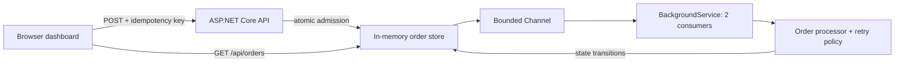

# OrderFlow

**Background jobs, made visible.** An original ASP.NET Core showcase by [Ramy Saleeb](https://github.com/RamySaleeb).

[](https://github.com/RamySaleeb/dotnet-orderflow/actions/workflows/ci.yml)

[](LICENSE)

Submit a fictional order and watch the backend work: queue admission, asynchronous processing, temporary failures, exponential backoff, and a terminal outcome. Repeat a request to see idempotency prevent duplicate jobs.

This is a **local, executable engineering demo**. There is no hosted deployment. The dashboard calls a real ASP.NET Core API and `BackgroundService`; only fulfillment is simulated. No customer data, payment provider, private code, or commercial system is involved.

## Run it in two commands

Install the [.NET 10 SDK](https://dotnet.microsoft.com/download/dotnet/10.0), clone this repository, and from its root run:

```sh
dotnet test --configuration Release
dotnet run --project src/OrderFlow --urls http://localhost:5088
```

Open **http://localhost:5088**. No database, API key, frontend build, or external service is required.

## A two-minute walkthrough

| Try | What to watch | Why it matters |
| --- | --- | --- |
| **Smooth delivery → Queue an order** | HTTP 202; queued → processing → completed on attempt 1 | Request acceptance and job completion are distinct events. |
| **A bump in the road** | Attempts 1 and 2 fail; waits of 1s and 2s; attempt 3 completes | Retries have explicit delays and a finite budget. |
| **Retry budget exhausted** | Three failed attempts; a final Failed state | Permanent failure stays visible instead of retrying forever. |
| **Repeat last request** | The same order is returned; the count stays unchanged | The same session, key, and payload don't create another job. |
| Queue several orders | Two consumers work while additional orders wait | Concurrency is bounded independently of HTTP requests. |

The dashboard polls every second, so a short-lived Queued or Processing state may pass between snapshots. Every transition remains in the timeline. Order IDs are shortened in the UI; API responses contain the full UUID.

## Architecture



- **`Program.cs`** — HTTP validation, response semantics, dependency injection, security headers, submission rate limit, and static files.
- **`Orders.cs`** — immutable response snapshots, locked state transitions, scoped idempotency, bounded channel, retry policy, and hosted consumers.
- **`wwwroot/`** — responsive HTML/CSS/JavaScript dashboard with native keyboard controls and visible focus styles. No frontend framework.
- **`tests/OrderFlow.Tests/`** — concurrency, capacity, conflict, isolation, retention, cancellation, retry outcome, snapshot, and HTTP integration checks.

A single lock covers the idempotency check, queue admission, and store insertion. A consumer may dequeue immediately but cannot change state until insertion completes. Repeat requests return HTTP 200; new admissions return 202. A different payload for the same session/key returns 409.

## API examples

Both headers use non-empty UUIDs. `X-Demo-Session` separates the temporary order lists; it is a demo capability, **not authentication**. Keep it private if sharing a running instance.

```sh
curl -i http://localhost:5088/api/orders \
  -H 'Content-Type: application/json' \
  -H 'X-Demo-Session: 7e2e4888-3dc5-4da1-b7d2-9174fb011aa1' \
  -H 'Idempotency-Key: 13267869-9932-4906-b719-bc29d3a14e3a' \
  -d '{"scenario":"Recover"}'

curl http://localhost:5088/api/orders \
  -H 'X-Demo-Session: 7e2e4888-3dc5-4da1-b7d2-9174fb011aa1'
```

Repeat the POST unchanged for a replay. Change `Recover` to `Exhaust` with the same key to observe a 409 conflict. Allowed scenarios are `Success`, `Recover`, and `Exhaust`. `GET /health` returns 200 when the app is running.

## Deliberate limits and production tradeoffs

| Demo choice | Production direction |
| --- | --- |
| In-memory orders and `Channel<T>` | Durable queue, database, and transactional outbox so accepted work survives restarts. |
| At most 500 retained orders, 20 per session | Capacity planning, per-tenant quotas, monitoring, and explicit backpressure. |
| Terminal orders expire 30 minutes after completion/failure | Persistent retention and an explicit idempotency-key lifetime. Here expiry also ends the deduplication guarantee. |
| Two workers; retry delays occupy a consumer | Scheduled redelivery and jitter so retries don't monopolize workers or synchronize across services. |
| Deterministic fulfillment simulator | Timeout-aware adapters and classification of retryable versus permanent failures. |
| Random per-tab session stored in sessionStorage | Real authentication and authorization. Duplicated browser tabs may share the initial session. |
| Global limit of 60 submissions/minute | Distributed rate limiting and tenant-aware policies. GET polling is not rate limited. |
| Shutdown cancellation; pending work is lost | Durable recovery and graceful drain/requeue semantics. |

This does **not** claim exactly-once external effects or production readiness. The idempotency guarantee is process-local and applies only while the order is retained. Failed orders are visible; there is no real dead-letter queue, manual replay endpoint, checkout, inventory, or payment processing.

## Build and optional container

```sh
dotnet publish src/OrderFlow --configuration Release --output publish
# Optional, with Docker installed:
docker build -t orderflow .
docker run --rm -p 5088:8080 orderflow
```

The container runs as the .NET image's non-root application user. CI tests and publishes the app on pushes and pull requests. Docker is supplied as a convenience; no cloud resources are provisioned.

## Contribute

Read [CONTRIBUTING.md](CONTRIBUTING.md). Useful next steps include deterministic processor time tests, an optional durable queue adapter, and accessible announcements when order statuses change. Keep the zero-configuration local experience intact and document the guarantees of every new adapter.

## License

[MIT](LICENSE). Original educational code; not extracted from private or startup projects.
